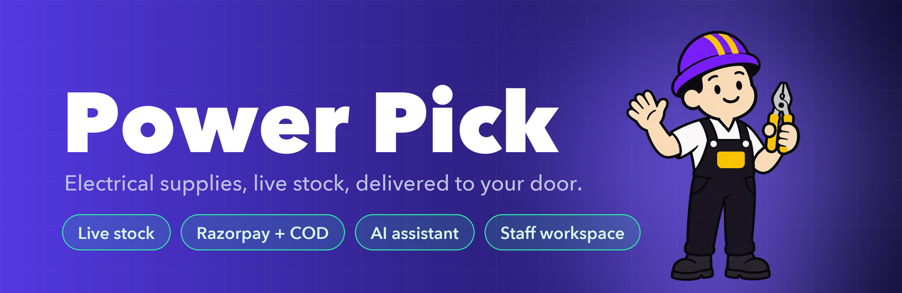

<p align="center">
  
</p>

<p align="center">
  
  
  
  
  
  
</p>

<p align="center">
  
  
  
  
  
  
</p>

# Power Pick

Power Pick is an online store for electrical supplies: wires and cables, MCBs, modular boards, switches and sockets, LED lighting, insulation, tools and testers. Electricians and homeowners compare ratings, pack sizes and live stock, pay online with Razorpay or in cash on delivery, and track their orders. A Groq-powered assistant answers product and order questions. Staff run the catalogue, stock, orders, payments, customers and assistant FAQs from their own workspace.

Built with Django 4.2, SQLite, the Django template language, hand-written CSS and vanilla JavaScript. There is no frontend framework and no build step.

## Contents

- [Features](#features)
- [Run it locally](#run-it-locally)
- [Configuration](#configuration)
- [Deployment](#deployment)
- [Payments and security](#payments-and-security)
- [Project layout](#project-layout)
- [Design](#design)

## Features

**Customers**
- Home page with search, category shortcuts, featured in-stock products and brands.
- Catalogue with search, category, brand, price range, in-stock filter, sorting and pagination. Sizes and ratings of the same product are grouped as options on one listing.
- Product page with photo, specifications, price, live stock, option chips, quantity, add to cart, wishlist, reviews from verified buyers, and related and recently viewed products.
- Cart with live quantity updates and stock warnings. Checkout saves delivery details and re-checks price and stock before anything is reserved.
- Two ways to pay: **Razorpay** (UPI, cards, netbanking) with verified payment, retry and payment history, or **Cash on delivery**.
- Orders with history, status tracking (Pending, Confirmed, Processing, Shipped, Delivered or Cancelled), reorder and printable receipts.
- Accounts with registration, sign-in by username or email, profile, structured Indian delivery address, avatar, password change and wishlist.
- Assistant that greets you, finds products by rating or use, quotes live price and stock, explains ordering and payment, and shows a signed-in customer their own order status.

**Staff** (`/staff/`)
- Overview of orders needing action, payments to review, low stock, revenue and a 14-day order chart.
- Products (add, edit, photo, availability, delete or deactivate), inventory and categories.
- Orders with valid status transitions, a Razorpay payment re-check, and **Mark cash collected** for delivered cash-on-delivery orders.
- Payments list with filters and CSV export, customers (view, edit, deactivate), assistant FAQs, and their own profile and password.

**How payment methods behave**

| | Razorpay | Cash on delivery |
|---|---|---|
| Order starts as | Pending | Confirmed |
| Payment starts as | Unpaid, becomes Paid when verified | Unpaid until staff record the cash |
| Customer can cancel | While Pending and unpaid | While Pending or Confirmed |
| Stock | Reserved at checkout, returned once if cancelled | Same |

## Run it locally

You need Python 3.9 or newer and about 200 MB of disk space. The steps below work on macOS and Linux; Windows notes follow.

```bash
# 1. Get the code and open the project folder
cd PowerPick

# 2. Create and activate a virtual environment
python3 -m venv .venv
source .venv/bin/activate

# 3. Install the dependencies
pip install -r requirements.txt

# 4. Create your settings file, then edit it (see Configuration below)
cp .env.example .env

# 5. Create the database and load the demo shop
python manage.py migrate
python manage.py seed_demo        # 36 products in 8 categories and about 99 assistant FAQs
python manage.py seed_reviews     # optional sample reviews (remove them with --clear)

# 6. Create a staff account
python manage.py create_staff --username admin --email you@example.com

# 7. Start the server
python manage.py runserver
```

Open <http://127.0.0.1:8000/> for the shop and <http://127.0.0.1:8000/staff/> for the staff workspace. Django's data admin is at <http://127.0.0.1:8000/admin/>. All three use the shop's own sign-in, which accepts a username or an email address.

`seed_demo` is safe to run again: it adds missing records, keeps staff edits and refreshes unedited seeded FAQ answers.

**Windows:** create the environment with `py -m venv .venv`, activate it with `.venv\Scripts\activate`, and copy the settings file with `copy .env.example .env`. The other commands are the same.

**What works without keys:** browsing, cart, accounts, cash on delivery and the staff workspace need no keys at all. Without Razorpay keys the online payment page shows a "payments unavailable" message. Without a Groq key the assistant answers from the local FAQ and catalogue.

## Configuration

Settings are read from the environment, or from a `.env` file in the project folder. Never commit `.env`.

| Variable | Purpose |
|---|---|
| `DJANGO_SECRET_KEY` | Long random secret. Required when `DJANGO_DEBUG` is `false`. |
| `DJANGO_DEBUG` | `true` on your computer, `false` on a live site. |
| `DJANGO_ALLOWED_HOSTS` | Comma-separated host names, for example `localhost,127.0.0.1`. |
| `DJANGO_CSRF_TRUSTED_ORIGINS` | Space-separated origins such as `https://yourname.duckdns.org`. Needed on a live site. |
| `RAZORPAY_KEY_ID`, `RAZORPAY_KEY_SECRET` | Razorpay API keys (or `RZP_KEY_ID`, `RZP_KEY_SECRET`). The code accepts `rzp_test_` keys only. |
| `RAZORPAY_WEBHOOK_SECRET` | Signing secret for the `/payments/webhook/` endpoint. |
| `GROQ_API_KEY` | Groq key for the assistant (or `GROQ_API`). |
| `GROQ_MODEL` | Optional. Defaults to `openai/gpt-oss-20b` and falls back to `openai/gpt-oss-120b` when rate limited. |
| `DATA_DIR` | Folder for `db.sqlite3` and uploaded photos. Defaults to the project folder; the Docker image uses `/data`. |
| `STAFF_USERNAME`, `STAFF_EMAIL`, `STAFF_PASSWORD` | Optional. `python manage.py ensure_staff` (run on container start) creates this staff account if it is missing. |
| `STORE_CONTACT_NAME`, `STORE_CONTACT_EMAIL`, `STORE_CONTACT_PHONE`, `STORE_CONTACT_ADDRESS` | Optional. Shown on the Contact page. |

Generate a secret key with:

```bash
python -c "from django.core.management.utils import get_random_secret_key; print(get_random_secret_key())"
```

Secret keys never reach the browser.

## Deployment

> **Why a VPS and not a paid platform?** This is a mini-project with a limited scope, so we host it on a VPS we already own (an Oracle Cloud Always Free ARM server) instead of a managed platform. The few extra pieces we added for that are a `Dockerfile`, a short start script, a GitHub Actions workflow that builds the image, a small Docker Compose file, and a free DuckDNS subdomain for the address. The same steps work on **any VPS** that can run Docker. In a real-world project we would weigh the options properly and host on a paid plan of a managed platform, with managed databases, backups, uptime guarantees and a custom domain.

How it fits together:

```
git push  ->  GitHub Actions builds the image  ->  ghcr.io/colorblakc/powerpick:latest
                                                          |
your VPS:  Docker Compose runs the image  ->  nginx (HTTPS, certbot)  ->  https://yourname.duckdns.org
                                                          ^
                                   DuckDNS container keeps the name pointed at the VPS
```

- **The image** is built for both Intel/AMD and ARM servers on every push to `main` (`.github/workflows/docker.yml`) and published as a public package, so the server needs no login to pull it.
- **On start** the container runs `migrate`, loads the 36 demo products (`seed_demo`, safe to repeat) and creates the staff account from `STAFF_*` if it does not exist (`docker-entrypoint.sh`).
- **Data** (the SQLite database and uploaded photos) lives in a Docker volume on the VPS disk, so it survives restarts and updates.

### What you need

- A VPS with Docker and Docker Compose (Ubuntu or Debian is easiest). Install Docker with `curl -fsSL https://get.docker.com | sudo sh`.
- Ports **80 and 443** open to the internet, in the cloud provider's firewall and in the server's own firewall. On Oracle Cloud that means an ingress rule in the VCN security list plus `iptables` rules on the instance.
- A free [DuckDNS](https://www.duckdns.org) account.

### 1. Claim a DuckDNS name

Sign in at duckdns.org, add a name (for example `powerpick`), and copy your **token** from the top of the page. DuckDNS names are shared by everyone, so pick one that is free.

### 2. Get the deployment files onto the server

```bash
git clone https://github.com/colorblakc/powerpick.git
cd powerpick/deploy
cp .env.example .env
cp powerpick.env.example powerpick.env
```

Edit the two files (`nano .env`, `nano powerpick.env`):

| File | What to set |
|---|---|
| `.env` | `DUCKDNS_SUBDOMAIN`, `POWERPICK_HOST` (the full `yourname.duckdns.org`) and `DUCKDNS_TOKEN` |
| `powerpick.env` | `DJANGO_SECRET_KEY` (a long random secret), `STAFF_EMAIL` and `STAFF_PASSWORD`, plus optional Groq and Razorpay keys |

Keep both files private; they are git-ignored. See [Configuration](#configuration) for every setting.

### 3. Start the app

```bash
sudo docker compose up -d
sudo docker compose logs -f powerpick     # Ctrl+C to leave the logs
```

The app now answers on `127.0.0.1:8001` and the DuckDNS container points your name at the server.

### 4. Put HTTPS in front of it (nginx and certbot)

If the server has no web server yet, run `sudo apt-get install -y nginx certbot python3-certbot-nginx`. Then create `/etc/nginx/conf.d/powerpick.conf`, replacing the host name:

```nginx
server {
    listen 80;
    server_name yourname.duckdns.org;
    client_max_body_size 10m;
    location / {
        proxy_pass http://127.0.0.1:8001;
        proxy_set_header Host $host;
        proxy_set_header X-Real-IP $remote_addr;
        proxy_set_header X-Forwarded-For $proxy_add_x_forwarded_for;
        proxy_set_header X-Forwarded-Proto $scheme;
    }
}
```

```bash
sudo nginx -t && sudo systemctl reload nginx
sudo certbot --nginx -d yourname.duckdns.org --redirect
```

certbot issues the free certificate and renews it automatically. A server that already runs nginx for other sites can simply have this file added; nothing else changes. If you prefer Caddy, a two-line `Caddyfile` does the same: `yourname.duckdns.org { reverse_proxy 127.0.0.1:8001 }`.

### 5. Check that it works

- Open `https://yourname.duckdns.org`, browse the shop and place a cash-on-delivery order.
- Sign in at `/staff/` with the staff account, move the order to Delivered and press **Mark cash collected**.
- With Razorpay test keys set, pay an online order. For the optional webhook, add `https://yourname.duckdns.org/payments/webhook/` in the Razorpay dashboard with the `payment.captured` and `order.paid` events and the same secret as `RAZORPAY_WEBHOOK_SECRET`.

### Updating, backups and starting again

- **Update:** push to `main`, wait for the **Actions** tab to show the image built, then on the server run `sudo docker compose pull && sudo docker compose up -d`. The data volume is kept.
- **Back up** the database and photos: `sudo docker run --rm -v deploy_powerpick_data:/data -v "$PWD":/backup alpine tar czf /backup/powerpick-data.tgz -C /data .` (the volume name starts with your folder name; check it with `sudo docker volume ls`).
- **Start again:** `sudo docker compose down -v` deletes the data volume; the next `up` recreates the demo shop and the staff account.

### Troubleshooting

| Problem | What to check |
|---|---|
| The address does not load | `sudo docker compose ps`, and make sure ports 80 and 443 are open in both firewalls. |
| Error 400 | `POWERPICK_HOST` in `deploy/.env` must be exactly the address you open. Restart with `sudo docker compose up -d`. |
| CSRF error on sign-in | The page must be opened over `https://`, and nginx must send `X-Forwarded-Proto`. |
| certbot fails | The DuckDNS name must already point at the server. Check with `getent hosts yourname.duckdns.org` and the DuckDNS container logs. |
| The DuckDNS container exits | `DUCKDNS_TOKEN` or `DUCKDNS_SUBDOMAIN` is empty in `deploy/.env`. |
| Online checkout unavailable | Check the `rzp_test_` key prefix and secret. |
| Assistant gives only short FAQ answers | Check `GROQ_API_KEY` and `GROQ_MODEL`. |

## Payments and security

- Prices and stock are authoritative on the server, and the price paid is saved on each order line.
- Razorpay orders are created by Django. Signatures are verified on the server, and the amount, currency, order id and ownership are cross-checked with Razorpay's API before an order is marked paid. Processing is idempotent and the webhook is signature-checked.
- Stock is reserved in a transaction at checkout and returned exactly once when an unpaid or cash-on-delivery order is cancelled.
- A payment that arrives after an order was cancelled is recorded and the order moves to **Payment review** so staff can resolve it in the Razorpay dashboard. Cancelling an order is not a gateway refund.
- Staff accounts are created only with `python manage.py create_staff` or `createsuperuser`. Nobody can choose staff rights when registering.
- Razorpay's checkout window shows a "Test Mode" ribbon while test keys are used. Going live needs live keys, removing the `rzp_test_` guard in `store/gateway.py`, and your own legal and payment review.

## Project layout

```
manage.py
requirements.txt
.env.example            copy to .env and fill in
Dockerfile              container image
docker-entrypoint.sh    start-up steps: migrate, seed, staff account, web server
deploy/                 Docker Compose file and settings examples for a VPS
.github/workflows/      builds and publishes the image on every push to main
powerpick/              settings, URLs, WSGI entry point
knowledge/faq_seed.md   assistant knowledge base, loaded by seed_demo
store/
  models.py             Profile, Category, Product, Order, OrderItem, Payment, FAQ, Wishlist, Review
  views.py              home, catalogue, product detail, cart, checkout, wishlist, reviews
  accounts.py           sign-in, registration, profile, orders, receipts, reorder, order cancellation
  gateway.py            Razorpay payment flow and webhook
  staff.py              staff workspace
  chat.py               Groq assistant with retrieval and fallbacks
  pages.py              help pages, robots.txt, error pages
  management/commands/  seed_demo, seed_reviews, create_staff, ensure_staff
  seed_assets/          demo catalogue data and product photos
  templates/            storefront, staff, registration and admin templates
  static/store/         design tokens, page CSS, JavaScript, fonts, brand art, payment logos
docs/banner.png         README banner
```

## Design

The visual identity is "Afterglow": midnight ink `#0D0B2E`, electric violet `#5B3DF5` for actions, switch mint `#2FDDA6` for live and in-stock states, a soft lilac ground `#F6F5FC`, amber for warnings and red for faults. Headings use Bricolage Grotesque and body text uses Figtree, both self-hosted. The electrician mascot appears in the logo and in empty and success states. Colours and spacing live in `store/static/store/tokens.css`, shared components in `ui.css`, and micro-animations in `motion.css` (all switched off for people who prefer reduced motion).
